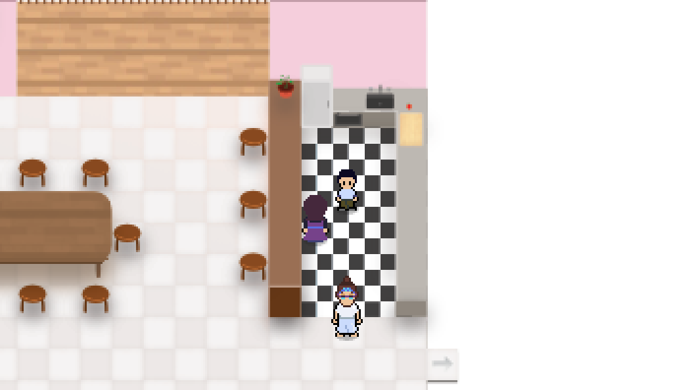
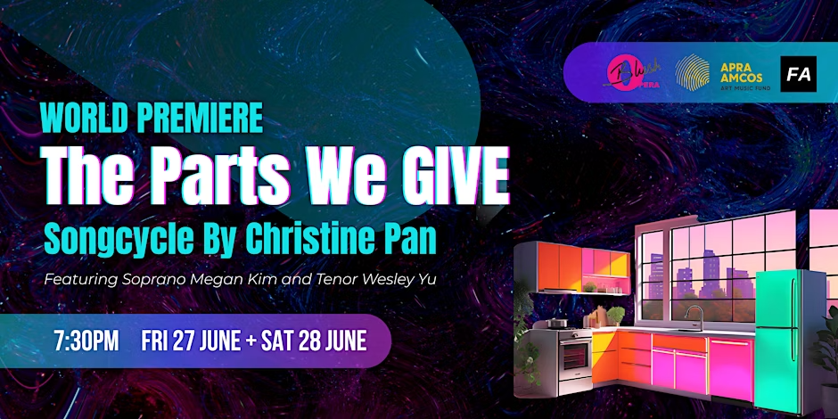

# The Parts We Give: The Game

A video game that accompanies Christine Pan's song cycle *The Parts We Give*. It premiered with the song cycle's world premiere (ESCAC by Brand X) on 27 June 2025.

**[Play it in your browser](https://danielpini.github.io/TPWG/)**



## About

You play two siblings, a brother and a sister, in their family home on the evening guests are due. Help your family get ready, run errands from room to room, and step in when things between family members get tense.

The story and quests were shaped with Christine Pan, who described the story and advised on which quests fit it. The music in the game is music from the song cycle.



## What's in it

- Two playable characters, with the brother and sister each seeing their own version of the house.
- Six rooms: living and dining room, kitchen, bathroom, kid's room, laundry and main bedroom.
- Timed quests with an on-screen guide arrow.
- Mediation quests, where multiple-choice conversations decide how a family moment plays out.
- Setting the table with collected plates and chopsticks, a fruit-chopping minigame, and a Nerf clean-up.
- Music from the song cycle, and progress saved in the browser.

## Controls

Arrow keys to move. Enter to talk and select. Escape to pause and open the menu.

## How it's built

Plain JavaScript, HTML canvas and CSS, with no framework and no build step. GitHub Pages serves the files as they are.

To run it locally, serve the folder with any static file server and open it in a browser:

```sh
python3 -m http.server 8000
# then open http://localhost:8000
```

## Credits

A FABLE ARTS production. Created, produced and coded by [Daniel Pini](https://bag-o-birds.com). Music and story consultation by Christine Pan.

The game began as a project inspired by [Drew Conley](https://www.youtube.com/@DrewConley)'s *Pizza Legends* tutorial series, and it owes him a lot. It has since been rebuilt around its own story, characters, maps, quests and music.

## Rights

The game © 2025 FABLE ARTS. *The Parts We Give*, its story and its music © Christine Pan, licensed to FABLE ARTS. All rights reserved. The source is public so you can read it, but it isn't open source.
